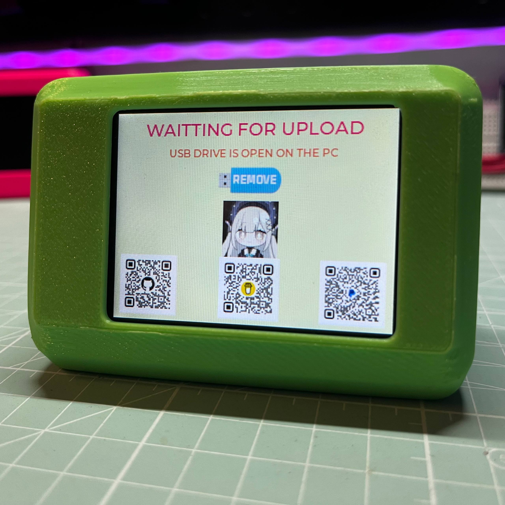
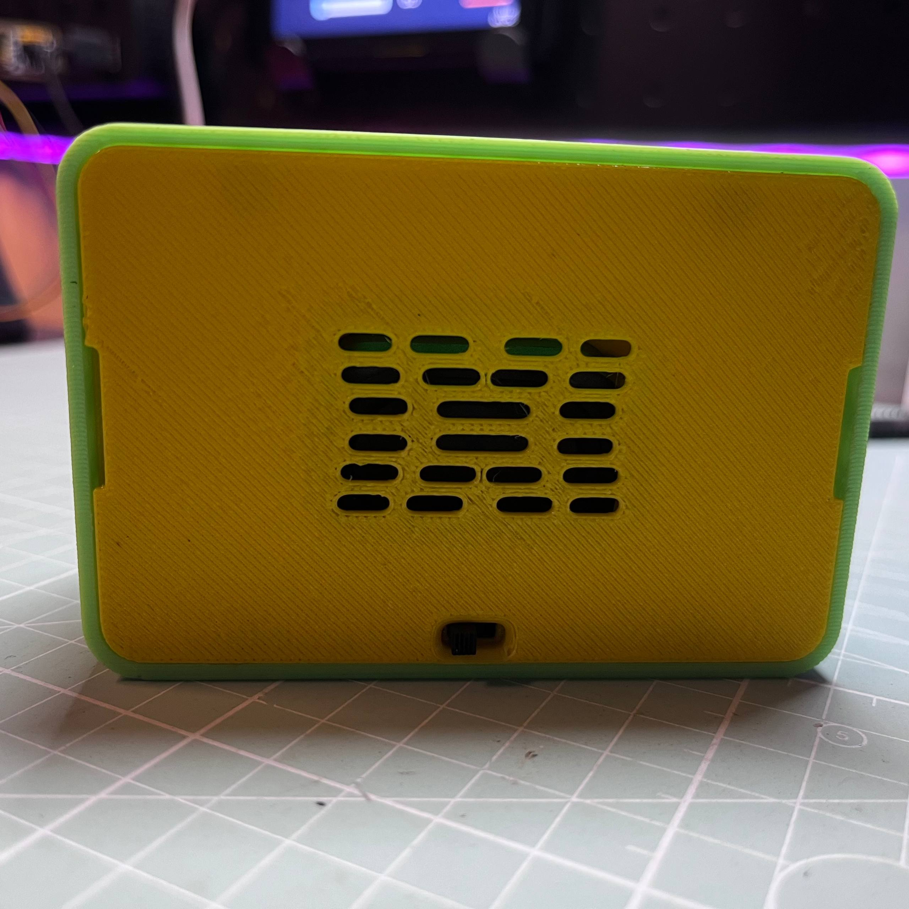
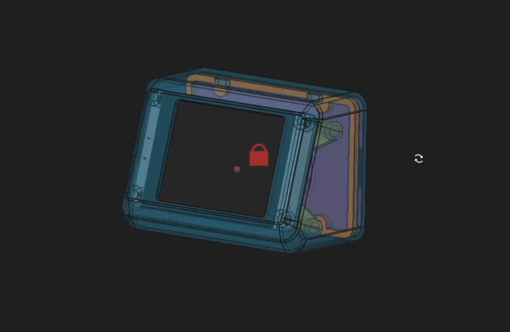
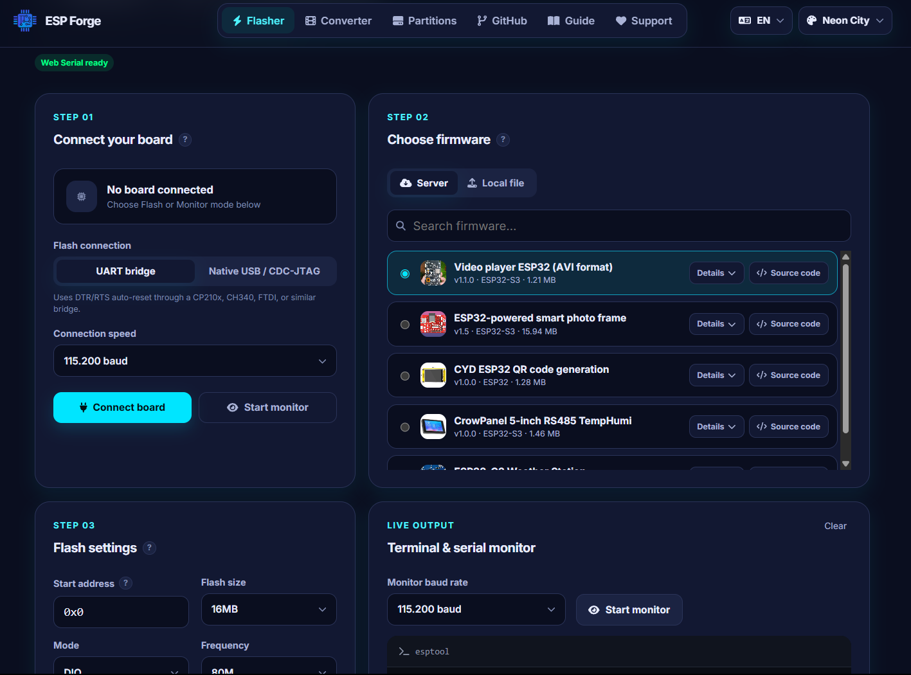
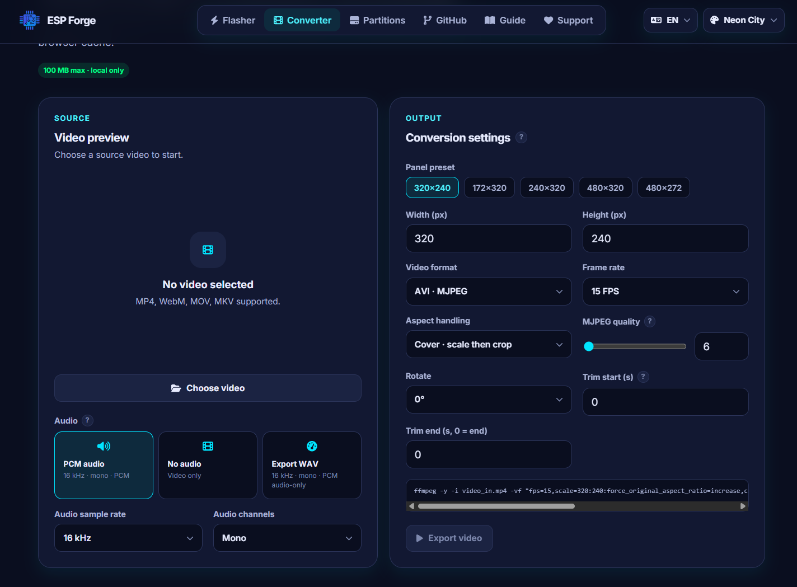

[](https://www.espressif.com/en/products/socs/esp32)
[](https://code.visualstudio.com/)
[](https://github.com/pangcrd)
[](https://www.youtube.com/@pangcrd)
[](https://www.buymeacoffee.com/pangcrd)
[](https://www.paypal.me/vnbg)
[](https://me.momo.vn/xmsli3iKtAsdfviV)

# PocketCinema — Open-Source Pocket Video Player on ESP32-S3

> A single-purpose pocket video player: copy one `.avi` file to a microSD card and watch right away. No phone, no streaming, no account, no ads.

**Open source under the MIT License** — use it, modify it, build your own, and share it. See [License](#license) below.

**No IDE, no compiling needed to get started** — flash the ready-made firmware straight from your browser with [ESP Forge](https://tools.pangcrd.com), then just copy videos and watch.

**Language / Ngôn ngữ:** [English](#english) · [Tiếng Việt](#tiếng-việt)

| Front view | Back view |
|---|---|
|  |  |

---

## English

### What is PocketCinema?

PocketCinema is an **open-source** pocket video player built on ESP32-S3, released under the **MIT License**. Copy an `.avi` file to the microSD card, turn it on, and it auto-plays. It does one job only — play video — so nothing interrupts the movie: no calls, no messages, no notifications, and no internet needed.

You do not need to build the code yourself to use it: the firmware is available ready-made on ESP Forge, so you can flash it from the browser with no IDE and no compiling (see Quick start). Build from source only if you want to change something.

### Why a single AVI file?

Most DIY players split video and audio into two files, for example `video.mjpeg` + `audio.wav`. That is easy to copy incompletely and easy to get out of sync.

PocketCinema plays **one interleaved AVI file (MJPEG video + PCM audio) directly**. One file to copy, and audio and video stay in sync by design because they live in the same container.

### Features

- Auto-play the first video on the card at startup
- Play / pause for real — resume from the same frame
- Loop the current video only, with no auto-advance to the next file
- Next / Previous switches to another video, then loops that new video
- Video title, progress bar, and current / total time on the control panel
- Clean screen while watching — controls appear only when you touch, then hide again
- Battery playback, with a battery indicator at 20% / 50% / 100%
- USB copy: plug into a PC and the device appears as a USB drive (see Quick start)

### Controls

| Gesture / action | Result |
|---|---|
| Tap the middle of the screen | Show the full control panel for 3 seconds |
| Drag up / down on the left edge | Brightness up / down |
| Drag up / down on the right edge | Volume up / down |
| Flick up / down on the left or right edge | Brightness / volume ±10 |
| Play / Pause button | Pause, or resume from the same frame |
| Next / Previous button | Switch video, then loop the new video |

Volume mutes only at 0%. Above 0%, the slider maps to the audio codec range so low volume stays usable instead of going silent too early.

### Hardware

🔗 Electronic components

| Component | Spec | Buy link |
|---|---|---|
| ESP32-S3 N16R8 capacitive display | ILI9341, 320×240, SPI, FT6336G capacitive touch | [AliExpress](https://s.click.aliexpress.com/e/_c3j84RKr) |
| N52 High-Strength Magnetic Hooks | 5×2 mm, N52 | [AliExpress](https://s.click.aliexpress.com/e/_c2yBtJR3) |
| Toggle switch SS-12F15 | 3 Pin | [AliExpress](https://s.click.aliexpress.com/e/_c3KTFigv) |
| M3 Brass Insert Nut | M3 × L5 × OD4 | [AliExpress](https://s.click.aliexpress.com/e/_c4oESJIv) |

### 3D enclosure

Print the enclosure yourself — the 3D files are on MakerWorld: **Click image to download**

[](https://makerworld.com/en/models/3427138-2-8-inch-cheap-capacitive-touch-display-enclosure)


### Quick start

No IDE, no ESP-IDF setup, and no compiling — the fastest way is the ready-made firmware:

1. Flash the ready-made firmware from ESP Forge in your browser (see Flash the firmware below).
2. Convert your video to AVI (command below), or use the video export tool on ESP Forge.
3. Copy the `.avi` file to the microSD card — either with a card reader, or by plugging PocketCinema into a PC.
4. Insert the card, turn the device on, and it auto-plays.

**Copy files over USB**

Plug PocketCinema into a PC and it appears as a USB drive. Copy new `.avi` files straight to the card, then press Eject on the device screen (or eject and unplug). The device returns the card to the player, refreshes the video list, and auto-plays. A plain charger does not take over the card, so you can charge and watch at the same time.

**Flash the firmware — ready-made, no IDE, no compiling**

You do not need to install an IDE, set up ESP-IDF, or compile anything. Flash the ready-made firmware straight from the browser with ESP Forge — a free browser tool for ESP32 that flashes firmware, converts video and manages partitions, with no install needed:

**ESP Forge: https://tools.pangcrd.com**

[](https://tools.pangcrd.com/flasher)


1. Open ESP Forge in a desktop browser and plug PocketCinema into the PC with a USB cable.
2. Pick the PocketCinema firmware and flash it from the page.
3. Unplug, insert the microSD card with your `.avi` files, and turn the device on.

Use the same page later to update to a newer firmware version. Building from source is optional, for people who want to modify the code.

The same site also provides the tool for exporting / converting video for the player.

### Convert a video to AVI

**Option 1 — on the web, no install (easiest)**

Convert your video in the browser with the ESP Forge Converter: pick your video file, export it as a PocketCinema-ready AVI, then copy it to the card.

[](https://tools.pangcrd.com/converter)


**Option 2 — with ffmpeg (offline)**

```bash
ffmpeg -i video_in.mp4 -vf "fps=10,scale=320:240:force_original_aspect_ratio=increase,crop=320:240" -c:v mjpeg -q:v 5 -pix_fmt yuvj420p -ar 16000 -ac 1 -c:a pcm_s16le video_out.avi
```

Copy `video_out.avi` to the microSD card and play.

### Known limitation

On fast, hard scene cuts you may see a diagonal black stripe / light tearing. This is a hardware limit of the ILI9341 panel without a TE (tearing effect) sync signal at SPI 40 MHz, not a playback bug. It does not affect normal viewing.

### License

PocketCinema is open source, released under the **MIT License**. You can use, copy, modify, merge, publish, distribute, sublicense, and sell copies, as long as the copyright notice and this permission notice stay in the copies. See the [LICENSE](LICENSE) file in this repository for the full text.

---

## Tiếng Việt

### PocketCinema là gì?

PocketCinema là máy xem phim bỏ túi **mã nguồn mở (open-source)** chạy trên ESP32-S3, phát hành theo **giấy phép MIT**. Chỉ cần chép file `.avi` vào thẻ microSD, mở máy lên là tự phát. Máy chỉ làm đúng một việc — phát video — nên không có gì cắt ngang bộ phim: không cuộc gọi, không tin nhắn, không thông báo, không cần mạng.

Bạn không cần tự biên dịch code mới dùng được: firmware có sẵn trên ESP Forge, nạp ngay trên trình duyệt, không cần IDE, không cần biên dịch (xem Cách dùng cơ bản). Chỉ khi nào muốn sửa code thì mới cần tự build từ mã nguồn.

### Vì sao chỉ dùng 1 file AVI?

Hầu hết máy tự chế tách video và tiếng thành 2 file, ví dụ `video.mjpeg` + `audio.wav`. Kiểu đó dễ chép thiếu file và dễ lệch tiếng.

PocketCinema chạy **trực tiếp 1 file AVI duy nhất (video MJPEG + audio PCM, ghép sẵn trong cùng 1 file)**. Chỉ cần chép 1 file, tiếng và hình đồng bộ sẵn vì nằm chung trong 1 container.

### Tính năng

- Tự phát video đầu tiên trong thẻ khi mở máy
- Play / Pause thật — dừng ở khung hình nào, phát tiếp đúng từ khung hình đó
- Chỉ lặp video đang xem, không tự chuyển sang video tiếp theo
- Next / Previous để chuyển video, sau đó lặp lại video mới đó
- Tên video, thanh tiến trình và thời gian hiện tại / tổng thời gian trên panel điều khiển
- Màn hình sạch khi xem — chỉ chạm mới hiện điều khiển, sau đó tự ẩn
- Chạy bằng pin, icon pin hiển thị 3 mức 20% / 50% / 100%
- Chép file qua USB: cắm vào PC, máy hiện lên như 1 ổ USB (xem Cách dùng cơ bản)

### Điều khiển

| Thao tác | Kết quả |
|---|---|
| Chạm giữa màn hình | Hiện full panel điều khiển trong 3 giây |
| Vuốt lên / xuống ở mép trái | Tăng / giảm độ sáng |
| Vuốt lên / xuống ở mép phải | Tăng / giảm âm lượng |
| Flick lên / xuống ở mép trái hoặc phải | Độ sáng / âm lượng ±10 |
| Nút Play / Pause | Tạm dừng, hoặc phát tiếp đúng khung hình đó |
| Nút Next / Previous | Chuyển video, rồi lặp lại video mới |

Âm lượng chỉ tắt tiếng hẳn ở mức 0%. Từ 1% trở lên, thanh trượt được ánh xạ vào dải của codec âm thanh để mức nhỏ vẫn nghe được, không bị mất tiếng quá sớm.

### Phần cứng

🔗 Linh kiện điện tử

| Linh kiện | Thông số | Link mua |
|---|---|---|
| ESP32-S3 N16R8 capacitive display | ILI9341, 320×240, SPI, cảm ứng điện dung FT6336G | [AliExpress](https://s.click.aliexpress.com/e/_c3j84RKr) |
| N52 High-Strength Magnetic Hooks | 5×2 mm, N52 | [AliExpress](https://s.click.aliexpress.com/e/_c2yBtJR3) |
| Toggle switch SS-12F15 | 3 Pin | [AliExpress](https://s.click.aliexpress.com/e/_c3KTFigv) |
| M3 Brass Insert Nut | M3 × L5 × OD4 | [AliExpress](https://s.click.aliexpress.com/e/_c4oESJIv) |

### Vỏ in 3D

Tự in vỏ máy — file in 3D nằm trên MakerWorld:

[](https://makerworld.com/en/models/3427138-2-8-inch-cheap-capacitive-touch-display-enclosure)


### Cách dùng cơ bản

Không cần IDE, không cần cài ESP-IDF, không cần biên dịch — cách nhanh nhất là dùng firmware nạp sẵn:

1. Nạp firmware có sẵn từ ESP Forge ngay trên trình duyệt (xem mục Nạp firmware bên dưới).
2. Xuất video ra định dạng AVI (lệnh bên dưới), hoặc dùng tool xuất video trên ESP Forge.
3. Chép file `.avi` vào thẻ microSD — bằng đầu đọc thẻ, hoặc cắm PocketCinema vào PC.
4. Gắn thẻ vào máy, mở máy lên là tự phát.

**Chép file qua USB**

Cắm PocketCinema vào PC, máy sẽ hiện lên như 1 ổ USB. Chép file `.avi` mới thẳng vào thẻ, rồi bấm Eject trên màn hình máy (hoặc eject rồi rút cáp). Máy sẽ trả thẻ lại cho trình phát, làm mới danh sách video và tự phát tiếp. Cắm sạc thường thì không bị chiếm thẻ, vừa sạc vừa xem được.

**Nạp firmware — có sẵn, không cần IDE, không cần biên dịch**

Không cần cài IDE, không cần cài ESP-IDF, không cần biên dịch gì cả. Nạp firmware có sẵn ngay trên trình duyệt bằng ESP Forge — tool miễn phí chạy trên trình duyệt cho ESP32, dùng để nạp firmware, xuất video và quản lý phân vùng, không cần cài đặt:

**ESP Forge: https://tools.pangcrd.com**

[](https://tools.pangcrd.com/flasher)

1. Mở ESP Forge bằng trình duyệt trên máy tính, cắm PocketCinema vào PC bằng cáp USB.
2. Chọn firmware PocketCinema và nạp ngay trên trang.
3. Rút cáp, gắn thẻ microSD đã có file `.avi`, mở máy lên là xem.

Sau này muốn lên bản firmware mới cũng nạp lại trên cùng trang này. Tự build từ mã nguồn là tuỳ chọn, dành cho ai muốn sửa code.

Trang này cũng là tool hỗ trợ xuất / chuyển đổi video cho máy.

### Xuất video ra AVI

**Cách 1 — xuất trên web, không cần cài gì (dễ nhất)**

Xuất video ngay trên trình duyệt bằng ESP Forge Converter: chọn file video, xuất ra file AVI dùng được cho PocketCinema, rồi chép vào thẻ.

[](https://tools.pangcrd.com/converter)

**Cách 2 — dùng ffmpeg (offline)**

```bash
ffmpeg -i video_in.mp4 -vf "fps=10,scale=320:240:force_original_aspect_ratio=increase,crop=320:240" -c:v mjpeg -q:v 5 -pix_fmt yuvj420p -ar 16000 -ac 1 -c:a pcm_s16le video_out.avi
```

Chép `video_out.avi` vào thẻ nhớ là xem được.

### Giới hạn đã biết

Ở những cảnh chuyển nhanh, cắt cứng, đôi lúc sẽ thấy vệt đen chéo / xé hình nhẹ. Đây là giới hạn phần cứng của màn ILI9341 không có tín hiệu đồng bộ TE (tearing effect) ở SPI 40 MHz, không phải lỗi phát video. Mức này không ảnh hưởng việc xem thông thường.

### Giấy phép

PocketCinema là mã nguồn mở, phát hành theo **giấy phép MIT**. Bạn được dùng, sao chép, sửa đổi, gộp, phát hành, phân phối, cấp phép lại và bán các bản sao, miễn là giữ lại thông báo bản quyền và thông báo giấy phép này trong các bản sao. Xem file [LICENSE](LICENSE) ở gốc repo để đọc toàn văn.

---

## License

PocketCinema is open source under the **MIT License** — see the [LICENSE](LICENSE) file in this repository.

## ESP Forge

Flash the ready-made firmware — no IDE, no compiling — and export video for PocketCinema / Nạp firmware có sẵn — không cần IDE, không cần biên dịch — và xuất video cho PocketCinema:

https://tools.pangcrd.com
